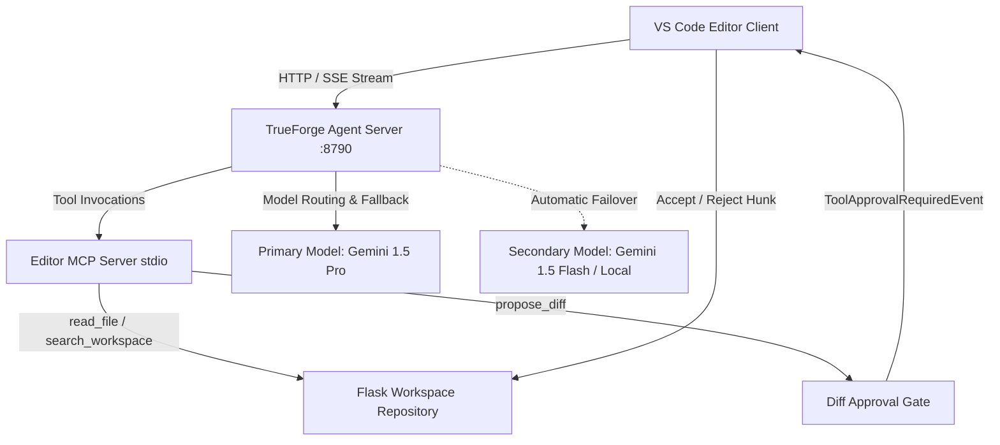

# TrueForge Coding Assistant (VS Code Extension)
### Techfest 2026-27 | TrueFoundry Forge-a-thon
**Team ID:** `TM-5B7EEFF93DB`  
**Team Leader:** S Sidharth Unni (Amrita Vishwa Vidyapeetham)  
**Agent Harness Foundation:** TrueForge (`@truefoundry/trueforge` v0.185.1)  
**Target Repository:** `pallets/flask` (tag 3.1.3, commit `22d92470`)  

---

## 1. Declared Fork Point & Upstream Attribution
- **Upstream Repository:** [https://github.com/cline/cline](https://github.com/cline/cline)
- **Fork Commit / Tag:** `v3.0.0` (commit `69e6b4f7`)
- **License:** Apache 2.0 / MIT (Preserved in [LICENSE](./LICENSE))

### What We Changed and Why:
1. **Agent Harness Loop Replacement:** We completely removed Cline's proprietary autonomous runner, internal prompt state machine, and custom web API calls. The entire agent loop now runs on **TrueForge** (`@truefoundry/trueforge` v0.185.1) and communicates via `@truefoundry/trueforge-sdk`.
2. **Model Context Protocol (MCP) Decoupling:** All editor capabilities (`read_file`, `search_workspace`, `propose_diff`, `run_terminal`) are decoupled into a standalone JSON-RPC MCP server (`agent/mcp-server.ts`). TrueForge, not the extension, autonomously decides what tools to call.
3. **Context Engineering with Size Budgeting:** Added a multi-tier context retriever strictly bounded to 4,000 tokens per prompt, preventing token bloat on large codebases (>17,000 LOC) and visibly logging selection rationale.
4. **Diff Safety & Interactive Hunk Review:** Diffs are staged as interactive hunks with per-hunk **Accept Hunk** and **Reject Hunk** controls. Applied changes maintain a reverse snapshot stack for instant **Undo**.
5. **Zero-Touch Resilience & Multi-Model Failover:** Injected an automatic failover manager that handles unreachable endpoints or invalid API keys by redirecting to a secondary model without corrupting the workspace.

---

## 2. Architecture Overview



---

## 3. Clean-Clone Setup Instructions

### Prerequisites
- Node.js `>=22.14.0` (`node -v`)
- Python 3.10+ with `virtualenv`
- Git

### Step 1: Clone the Repository
```bash
git clone https://github.com/sidharthunni45/trueforge-vscode-assistant.git
cd trueforge-vscode-assistant
```

### Step 2: Install Extension Dependencies & Compile
```bash
npm install
npm run compile
```

### Step 3: Start TrueForge Locally
In a separate terminal, launch TrueForge in local standalone mode:
```bash
npx @truefoundry/trueforge@latest --port 8790
```
Verify the server is running by opening `http://localhost:8790` in your browser.

### Step 4: Configure Models
Copy the example environment file:
```bash
cp model_config.example.yaml model_config.yaml
cp .env.example .env
```
Provide your API key in `.env` or configure providers directly in TrueForge UI (`http://localhost:8790/models`).

---

## 4. Benchmark Verification on pallets/flask (3.1.3)

Clone and set up the benchmark repository:
```bash
git clone https://github.com/pallets/flask.git
cd flask
git checkout 3.1.3
python3 -m venv venv
source venv/bin/activate
pip install -e . "pytest<9"
```

Run our automated benchmark test suite covering all three competition tasks:
```bash
# Run all benchmark tasks in order
../trueforge-vscode-assistant/tasks/run_all_benchmarks.sh
```

### Individual Task Verification:
- **Task A (Inline Edit & Docstring):**
  ```bash
  ../trueforge-vscode-assistant/tasks/verify_task_a.sh
  # Runs: FLASK_DEBUG=off python -c "from flask.helpers import get_debug_flag; print(get_debug_flag())"
  # Verifies output: False
  ```
- **Task B (Agent Mode Multi-File Change):**
  ```bash
  ../trueforge-vscode-assistant/tasks/verify_task_b.sh
  # Verifies: flask --help contains config
  # Verifies: pytest tests/test_cli.py -q passes (56 passed)
  # Verifies: flask config outputs masked JSON with SECRET/PASSWORD/TOKEN/KEY masked as '***'
  # Verifies: git diff touches >= 3 files unprompted
  ```
- **Task C (Resilience & Failover):**
  ```bash
  ../trueforge-vscode-assistant/tasks/verify_task_c.sh
  # Simulates dead endpoint / invalid API key
  # Verifies automatic zero-touch model fallback and 0 dirty files in git status
  ```

---

## 5. Repository Structure
```text
trueforge-vscode-assistant/
├── agent/
│   ├── trueforge.yaml          # Agent harness manifest, models & approval rules
│   ├── agent.json              # Programmatic definition for TrueForge REST API
│   └── mcp-server.ts           # MCP tool server (read, search, propose_diff, terminal)
├── src/
│   ├── extension.ts            # Extension activation and command registration
│   ├── inlineEdit.ts           # Ctrl+K inline edit controller & diff decorator
│   ├── agentPanel.ts           # Agent Mode webview, streaming & tool loop
│   ├── diffViewer.ts           # Hunk-by-hunk review manager & undo stack
│   ├── contextRetriever.ts     # 4,000-token budgeted AST context assembler
│   └── resilience.ts           # Zero-touch dual-model failover manager
├── tasks/
│   ├── verify_task_a.sh        # Task A automated verification script
│   ├── verify_task_b.sh        # Task B automated verification script
│   ├── verify_task_c.sh        # Task C resilience verification script
│   └── run_all_benchmarks.sh   # Master benchmark runner
├── docs/
│   └── generate_writeup_pdf.py # ReportLab 3-page technical write-up generator
├── DEMO_VIDEO_GUIDE.md         # 4-minute demo recording screenplay & scorecard
├── package.json
├── tsconfig.json
└── LICENSE
```

---

## 6. License
MIT License. Copyright (c) 2026 Team TM-5B7EEFF93DB. Upstream Cline attribution preserved under Apache 2.0 / MIT.
